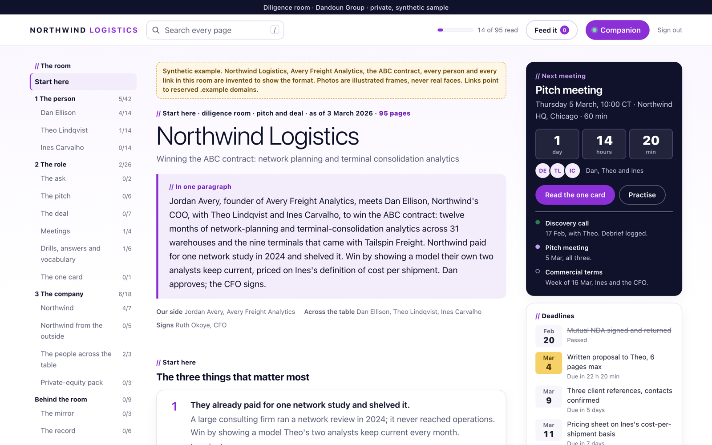
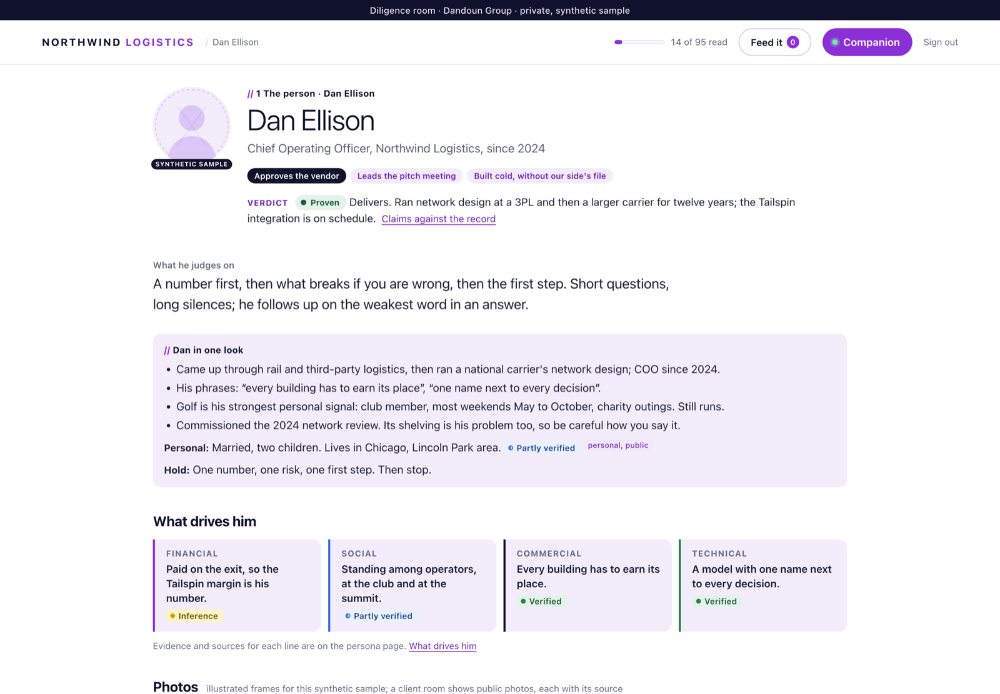
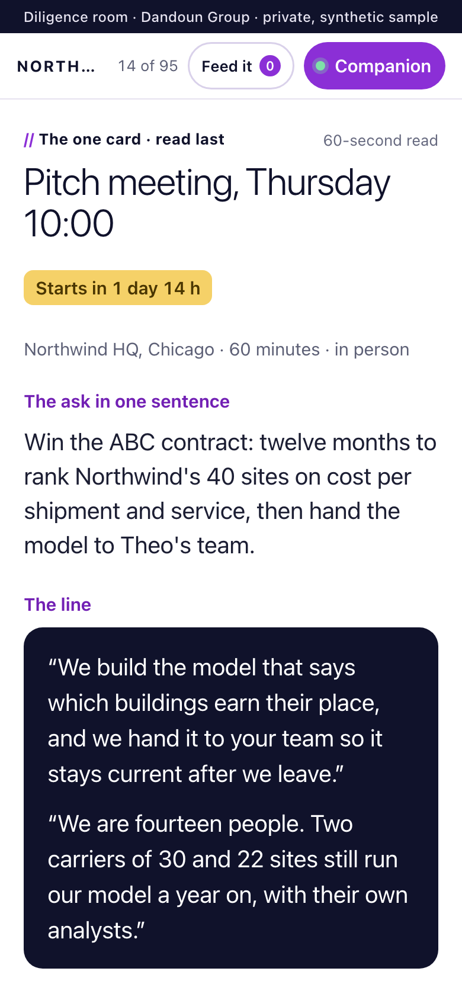
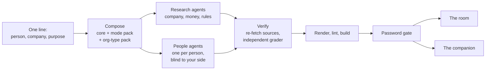
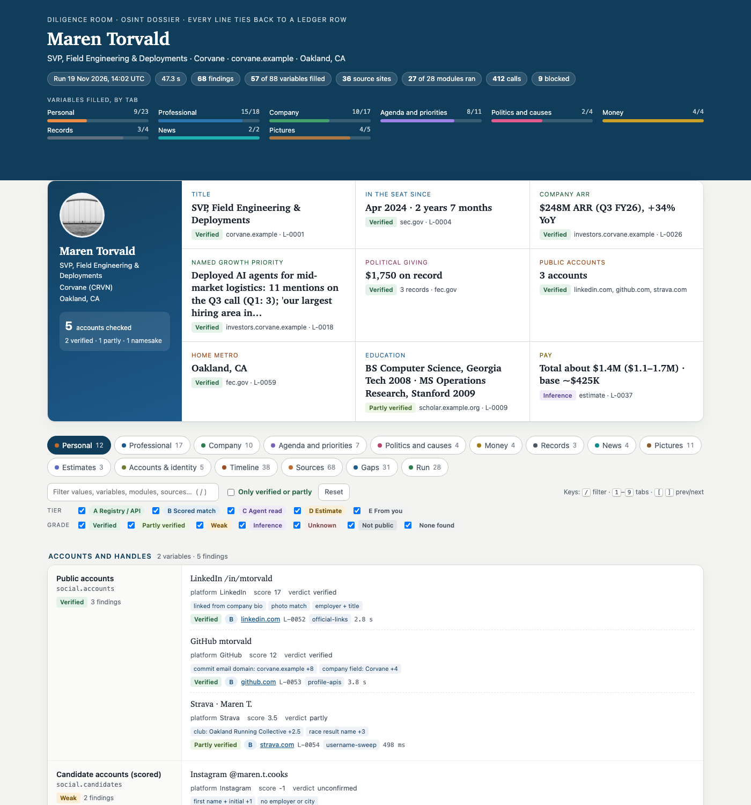

# Diligence rooms

[](https://github.com/anader298/diligence-rooms/actions/workflows/test.yml)

Due diligence on a company and the people you are about to meet. Type who you are meeting, their company and what the meeting is for. Get a private room built from graded public sources and our licensed data (Apollo), with a live companion for the meeting itself. Built to prepare for high-stakes meetings: deals, partnerships, interviews. Rooms are built privately, on your own machine, with your own AI account.



*Every screenshot shows synthetic data. The companies, their people and every link are invented.*

**Case study:** [How a private room prepares you for the people across the table](https://dandoungroup.com/case-studies/#diligence)

**Run it yourself:** clone it, connect your own Claude Code or Codex, and build rooms on your machine. Tested from a fresh download on 19 November 2026: a light room on a public company, built unattended with Claude Code, passed the depth check at 100/100 (57 pages, 324 sources). See [Launch it on your machine](#launch-it-on-your-machine).

**A person's section.** Headshot frame, the verdict, what he judges on, and what drives him under four headings.



**The persona.** Proven, Mixed or Unproven in one line, then each claim set against the record, graded and sourced.


**The org chart.** Every seat, tenure, the open seat, reporting and committee lines. The people at the next meeting are ringed.


**The company.** What drives it, with evidence and a source on each line, and the charts behind it.


**Practice.** Pitch clock, scorecard on their criteria, flashcards, objections and mock meetings, saved in the browser.


**On a phone.** The one card, read last, and the companion, glanced at during the meeting.

<p align="center">

&nbsp;&nbsp;

</p>

## The problem

Before you sign a contract, take on a partner, pick a vendor or put money into a company, the other side knows its business far better than you do. Most of what you need is public: filings, accounts, regulators' records, the company's own documents, and a lot about the people you will meet, from their talks and posts to reviews by people who worked for them. Nobody assembles it around the people and the decision, so most teams walk in with a home-page read or pay for a consultant's brief.

## What it delivered

From the rooms built between August and November 2026, as published in the case study:

- **Eight counterparties diligenced:** three full rooms, on a global consulting firm, an institutional asset owner and a fintech, and five lighter packages on three private equity firms and two venture-backed startups.
- **16 personas** of the people across the table, built from public sources only, each one usable to rehearse the meeting before it counts.
- **A filings bank of 36 instruments** for the asset owner, each graded by how it was verified, alongside five years of its annual reports and a decade of regulatory correspondence.
- **Faster each time.** The method moved between rooms unchanged. The second full room took three days from intake, the third took one.
- **Honest about outcomes.** A room gets you into the meeting prepared. It does not decide the result: one room ended after the second meeting without an agreement, one counterparty has had a first meeting with no result recorded, and for one the room was built and nothing was sent.

## How it works



- **One line in, a whole room out.** A local studio reads the person, the company and the purpose, picks a mode (deal, audit, pitch, or interviewing) and an organisation type (private equity, public company, asset owner, startup and five more), and composes the page set. Composing takes seconds; research runs only when you start it.
- **The company first, then its people.** Pages cover who they are, their money, public financials, the rules they work under, filings, partners, reviews and news. Each person across the table gets their own pages, from public record and network to a profile of how they judge.
- **Three sections to open.** The reader sees **Start here** on top (summary, countdown and deadlines, the three things), then **1. The person**, one block per person split into Personal and Professional, **2. The role, the deal, the specifics** (the ask, the deal pages, meetings and the companion, the drills, the one card) and **3. The company** (who they are and what drives them, the money, filings, the outside view, the org chart and people map, the org-type pack). The mirror and the record sit in a closed **Behind the room** at the bottom.
- **A verdict, motives and photos.** Each persona opens with a verdict, **Proven**, **Mixed** or **Unproven**: one plain line, then their claims against the record, each graded and sourced. "What drives them" covers the person and the company under four headings: financial, social, commercial and technical. A headshot frame and life photos, each with its source, sit on the person pages.
- **Public sources plus our licensed data.** Lookups run on our own Apollo account; the client connects nothing. Licensed data counts as partly verified until a public source confirms it. More providers can be added later.
- **Agents in parallel, blind where it matters.** Claude Code agents gather and draft every page with a source link on each line. The people agents never read your side's file, so the profiles cannot flatter you. A separate agent re-fetches every source and recomputes every number; that check is a model, not code (see Methodology).
- **Every fact graded.** Each one is verified, partly verified, weak, inference, none found, not public or unknown. The reader's pages show what was found; every search, including the empty ones, is kept in the OSINT log behind the room. `npm run lint` scores each room out of 100 on sources, verified share and pages still empty.
- **A companion with two lanes.** During the meeting, a phone page transcribes the conversation in 8-second chunks. A fast model shows a quick card when it hears a question. A stronger model, with the whole room as a cached prompt, writes the considered answer a few seconds later. If the room does not cover the question, the card says so.
- **A gate at the edge.** One Netlify Edge Function guards every room with its own password and a signed, HttpOnly session cookie. A room with no password returns 404, so the site does not reveal which rooms exist. The companion's API sits behind the same gate.

The full method is in [`pipeline/STANDARD.md`](pipeline/STANDARD.md) and every agent brief is in [`pipeline/PROMPTS.md`](pipeline/PROMPTS.md).

## The sample room

[`examples/northwind-sample/`](examples/northwind-sample/) is the finished sample, as static pages: Avery Freight Analytics prepares to pitch Northwind Logistics for a network-planning contract, across the table from Dan Ellison (COO), Theo Lindqvist and Ines Carvalho. It ships twelve pages in full (the front page, Dan's section, his persona, personal life and circles, the company, the org chart, the one card, the practice dashboard, documents, glossary and the wider org) and lists the rest of the 95 so the shape of a whole room is visible. Open `examples/northwind-sample/index.html` in a browser; it makes no network calls. The Companion button is added by the build: run `npm run build` and `npm run preview`, then open `/northwind-sample/`.

[`rooms/northwind/`](rooms/northwind/) is the same counterparty as a source room (`room.json` plus page bodies), so `npm run build` shows how the engine renders a room: the groups, the person cards with their verdicts, the countdown, the grade donuts, the jump bar and the source chips.

## The helpers: answers on screen during the conversation

Preparation gets you into the room. The helpers keep the room with you while you are in it.

**Silent helper** ([`helper/SILENT-HELPER.md`](helper/SILENT-HELPER.md)). A single instruction file for Claude's voice mode. Load it into a Claude Project with the room's knowledge file, start voice mode and mute the speaker. It listens, never talks back, and prints a short card on screen for every question the other side asks: the question, one sentence to open with, three facts from the room, and the page they came from. If the room does not cover it, it says so and gives one honest bridge sentence. It knows who is speaking from the personas and shapes the answer to how that person judges.

**The companion** (`/<room>/assist.html`). The companion as a web page on a phone or a second screen, behind the room's password. It listens and helps while you talk, through two lanes:

- **Fast lane** (`ASSIST_FAST_MODEL`, default `claude-opus-5-5`). Audio is recorded in 8-second chunks and transcribed on the server, falling back to the phone's own speech recognition. The fast lane cleans up the rolling transcript, guesses who is speaking, and when it hears a question or a push-back it puts a quick card on screen within seconds: the question, one line to open with, and two or three facts with the room page each comes from.
- **Deep lane** (`ASSIST_DEEP_MODEL`, default `claude-fable-5-2`). For every question the fast lane spots, or when you press Think, it streams a considered answer underneath the card: the best answer in our words, the evidence from the room, what this person's persona is really testing, a question to ask back, and the risk to avoid. The whole room is the cached system prompt, so each call after the first pays only for the question and the transcript.

Quick cards stack with a pin and next control; a typed question box covers anything it missed; a silent mode turns off vibration and motion and dims the screen. The microphone stays off until you confirm that everyone in the conversation has agreed to be recorded (required in two-party consent states). The session (transcript, cards and deep answers) is saved on the device only and exports as a markdown file for the debrief. Every room has a `companion` page with the setup checklist. Open `assist.html#demo` to see it without a microphone or a model.

The build writes both helpers' knowledge for every room automatically: `site/<room>/knowledge.md` for the silent helper, and a JSON copy (with the people, meetings and summary) for the companion's functions.

## The data behind it

Public sources plus our licensed data (Apollo). We run our own Apollo account; a client is never asked to connect an account, share a login or send an export. The adapters for the other providers below stay in the code for later and are off unless enabled.

Licensed data replaces scraping. `npm run enrich -- <slug>` asks the enabled providers for the people and the company in a room. It prints a credit estimate per provider and stops; nothing is spent until you run it again with `--yes` (or confirm in the studio's Licensed data panel). Results land in `rooms/<slug>/work/connectors/`: one file per provider, `merged.json` with per-field provenance, and `conflicts.json` where providers disagree. Every value is graded partly, even when two providers agree, until the research stage confirms it at a public source.

Contact details are kept, not dropped. In small and owner-run firms the founder's personal email, mobile or house is often the business address too, so every email, phone and address a provider returns is stored with its kind (work, personal or unknown), phone type and source. The merge checks each one against the company's own records (website, state registry, SEC / Form ADV / Form D / 990, UCC, domain WHOIS, saved in `work/business-records.json`) and marks a match "business of record". Rooms show them in a "Contact routes" table (Value, Kind, Business of record?, Source, Grade). `revealPersonal` in `config/connectors.json` (default on) asks providers for personal emails and mobiles where they charge extra, and the estimate includes those credits.

**Boundaries.** Public or licensed sources only. Nothing on minors, no real-time location, no breached or leaked data, no logging in to see non-public content and no LinkedIn scraping. A residential address appears only when it is a contact or business address of record, labelled as such.

| Provider | What it fills | Auth | Status |
|---|---|---|---|
| Apollo.io | titles and history, seniority, departments, city, profile links, work email; work and personal emails, phones, address; company size, revenue, funding, tech, job postings, office address | `APOLLO_API_KEY`, or the Apollo MCP server in Claude Code (`apollo-mcp`, no key here) | verified endpoint |
| ZoomInfo | titles and history, education, seniority, departments, work email, direct line, mobile, street address; firmographics | `ZOOMINFO_USERNAME` + `ZOOMINFO_PASSWORD`, or `ZOOMINFO_ACCESS_TOKEN` | unverified endpoint |
| Lusha | current and past titles, seniority, departments, city, work and private emails, phones; company profile | `LUSHA_API_KEY` | verified (people); unverified endpoint (company) |
| Cognism | titles, seniority, department, city, emails, direct, office and mobile lines, address; company profile | `COGNISM_API_KEY` | unverified endpoint |
| Clay | whatever your table's enrichment columns return | `CLAY_WEBHOOK_URL`, then the table's CSV export | unverified endpoint |
| Crunchbase | funding rounds, investors, parent and subsidiaries, headcount range; people's jobs and degrees | `CRUNCHBASE_API_KEY` | verified (organization lookup); unverified endpoint (search, people, cards) |
| PitchBook | deals and investors, headcount, parent; people's positions and education | `PITCHBOOK_API_KEY` | unverified endpoint |
| LinkedIn export | current title and the date we connected (our own Connections.csv), Sales Navigator lists | files in `work/imports/linkedin/` | local file |
| CSV | anything in a CRM or data-room export, by column name | files in `work/imports/` | local file |

"Unverified endpoint" means the provider's reference is behind a customer login; the adapter follows the documented minimum and should be checked against the provider's docs before it is enabled. Enable providers in `config/connectors.json` (copy `config/connectors.example.json`); Apollo is the one in use.

## Public-source research in a minute: `npm run osint`

Before any AI agent starts, a scripted pass collects what public registries, APIs and pages say about each person and their company. It runs in about 30 to 45 seconds with no paid keys and no dependencies (Node's built-in fetch), and writes three files per person in `rooms/<slug>/work/osint/<person>/`:

- `ledger.jsonl`: one row per finding (L-0001 upward) with the value, source link, module, grade (verified, partly, weak, inference) and tier (A registry or API, B scored match, C read from a page, D estimate). This is the tie-back: a line on a room page cites its ledger id.
- `osint.json`: the ledger plus what was searched and not found, and how each module ran.
- `dossier.html`: everything in tabs (Personal, Professional, Company, Agenda and priorities, Politics and causes, Money, Records, News, Pictures, Estimates, Accounts and identity, Timeline, Sources, Gaps, Run), with a filter and grade toggles. The studio links it from the room's row.

```
npm run osint -- --name "Jane Doe" --company "Acme Corp" --domain acme.com --open
```

The research agents (P4a) start from this ledger, confirm each row at its source, and go where scripts cannot: their own web search, including image results and the preview snippets of pages they cannot open. They add what they find with `node scripts/osint/add.mjs`.



26 modules in four lanes (fast, sweep, slow, late), each with a time budget; a module that fails or is blocked is recorded, never fatal:

| Area | Modules and sources |
|---|---|
| Company | SEC EDGAR filings and XBRL financials; the 10-Q/10-K read for segments, KPIs, themes and litigation; the company's leadership page and press; job boards (Greenhouse, Lever, Ashby, Gem, SmartRecruiters, Workable, Recruitee, Jobvite, Paylocity, Workday, BambooHR); DOL Form 5500 benefit plans; Wikidata; news (GDELT, Google News RSS); DNS (mail provider and SaaS stack from TXT records); certificate transparency; the web archive |
| The person, professional | SEC Forms 3 and 4 (title, trades, holdings), the proxy (pay table, bio), 8-Ks; patents as inventor; Hacker News |
| The person, personal | web search (DuckDuckGo, SearXNG, Bing; Brave Search API with a key); a username sweep across about 35 sites that counts a hit only when the profile's name matches; public profiles (GitHub, Bluesky, Mastodon and others); image search and reverse image search on the headshot (Bing, Yandex, Wikimedia) |
| Politics and records | FEC donations and the company PAC; lobbying (lda.gov); federal awards (USAspending); OFAC and HHS-OIG exclusion lists; OpenSanctions and CourtListener with a free key |
| Late | an identity score for every candidate account (log-odds over name, employer, city, shared handles and headshot reuse; verified needs two kinds of evidence); estimates for team size, budget, pay, growth, deal size and timing, each a range with its inputs and formula |

**Tested on three real people (19 to 20 November 2026), scripted pass only:** a public-company EVP: 141 findings across 41 variables in 32 s (proxy pay to the dollar, Form 4 title and trades, revenue and ARR, segments, litigation, leadership and education, 27 open roles). A VP at a private manufacturer: 62 findings in 46 s (leadership bio and patents, 13 open roles, benefit-plan headcount, SaaS stack). A recruiter at a private software company: 70 findings in 30 s. The personal side is the weak half: unless the person posts publicly, hobbies, family and causes come back empty, and the dossier says so rather than guess. See [docs/osint.md](docs/osint.md) for the measured sources, what blocks and the free keys that help.

## The gate

One Netlify Edge Function (`netlify/edge-functions/room-gate.ts`) sits in front of every room. Each room has its own password, set as `ROOM_PASSWORD_<SLUG>` (slug upper-cased, dashes become underscores); a room with no password returns 404, so the site does not reveal which rooms exist. A correct password sets a signed, HttpOnly session cookie (HMAC-SHA256 with `ROOM_COOKIE_SECRET`, through Web Crypto); changing the secret signs everyone out. `/<room>/__logout` ends the session. The companion's functions sit behind the same gate, and every room is served with `noindex` and `no-store` headers.


## About this public copy

The live rooms are private. They hold research on real companies and real people, so they stay behind their passwords and are deleted when the meeting is done. This copy is sanitized: it holds the engine, the standard, the prompts and one synthetic sample, where Avery Freight Analytics prepares to meet Northwind Logistics about a network-planning contract. Every company, person and link in it is invented. The private version changes first, and its history holds real research, so it stays private. This copy was published as one commit on 12 November 2026, and every change since is its own commit.

## Boundaries

Public information only. No logging in to see non-public content, no fake accounts, no breached data, nothing on minors, and no home addresses or personal phone numbers on any page. Recording law differs by place: get every party's consent before you turn the companion on. This repo is a tool, not legal advice.

## Limits

- **A shared password per room, not accounts.** Anyone with the password can read the room. There is no rate limiting on the login form.
- **A room is only as good as what they publish.** Private companies stay partly dark. The pages say "not public" rather than guess.
- **Rooms go stale.** People leave between the build and the meeting. Every page carries its as-of date.
- **Inference creeps.** "In essentially every case" turned out to be six uses when recounted. The corrections log exists because it happens.
- **Self-grading is not evidence.** Practice answers are graded by something other than the persona that asked.
- **The live helper depends on the room and the mic.** Transcription takes a few seconds per chunk and garbles names; the answer is only as good as the room behind it.

## Stack

Static HTML, CSS and plain JavaScript built by a Node script, with no framework. Netlify Edge Functions (TypeScript) for the gate, with HMAC-SHA256 sessions from Web Crypto. Netlify Functions for the companion: Claude through the Anthropic SDK with prompt caching, and Gemini for speech to text, through Netlify AI Gateway. Claude Code agents for research. `node:test` for the gate, session, composer and lint tests.

## Licence

MIT. See [LICENSE](LICENSE).


## Methodology

Use: Analyze. Lever: commercial and risk. Before a negotiation, partnership talk or interview, a leader sees the counterparty's money, rules and people, with every claim sourced, and fewer surprises reach the table.

| Step | Done by | Check |
|---|---|---|
| Research the company and each person | Claude Code agents in parallel; people agents never see our side's file | A source link on every line; every search logged |
| Licensed data (Apollo) | Code; a person approves the spend | Nothing spent until `--yes`; values graded "partly" until a public source confirms |
| Verify sources and numbers | Separate model agents | Re-fetch and recount: a model checking a model |
| Companion cards in the meeting | Model, fast and deep lanes | `validateCard`: known type, grade, a source page on every fact; "Not in room" allowed |
| Companion calculations | Model picks inputs; code computes (`recheckCalc`) | The code's result replaces the model's |
| Publish a room; turn on the mic | Person | The pipeline never deploys; the mic stays off until everyone consents |

- **Playbook or agent, and why.** Mostly a playbook (`pipeline/STANDARD.md`, briefs P0 to P10). Research fans out to agents because the reading is broad and independent; one render step writes the pages; the companion is two fixed calls per question.
- **How it was built.** Personas that graded their own practice questions agreed with themselves, so grading moved to a separate agent.
- **How it's checked.** 94 tests (`npm test`). `npm run lint` fails the synthetic sample at 67/100: 16 pages against 40+, and 11 pages with no source link. Card accuracy is not measured yet.
- **Limits.** Card JSON is read with a regex, the fast lane defaults to an Opus-class model, and the research number check is a model. Next: structured outputs, a small fast model, a code tie-out and a labelled question set. See [Limits](#limits).

How I build with AI: [github.com/anader298/how-i-build-with-ai](https://github.com/anader298/how-i-build-with-ai)

## Author

Anthony Nader, Dandoun Group. Read the [diligence rooms case study](https://dandoungroup.com/case-studies/#diligence).

## Launch it on your machine

Everything runs locally, with your own AI account. Nothing is sent anywhere except the engine's own calls and the public sources it reads.

**You need:** Node 23.6 or later, git, and one of these, signed in or with an API key:
- [Claude Code](https://docs.claude.com/en/docs/claude-code) (`npm install -g @anthropic-ai/claude-code`, then run `claude` and type `/login`), or
- [Codex](https://github.com/openai/codex) (`npm install -g @openai/codex`, then `codex login`).

```sh
git clone https://github.com/anader298/diligence-rooms.git
cd diligence-rooms
npm install
npm run doctor          # checks Node, the engines, your sign-in and setup; prints the fix for anything missing
npm run studio          # http://localhost:8877, bound to this machine only
```

In the studio:

1. **Connect AI.** Pick Claude Code or Codex. Use the account you are signed in to, or paste an API key (saved only in `.env` on your machine; the page shows the last four characters and nothing else). Leave Model blank for the default. Press **Test**: it sends one short message and shows your current plan usage.
2. **Set the usage limit.** A run stops itself when your plan usage goes above this (default 65%), so a long build cannot use up your plan. Pages written before the stop are kept; press Run again after the window resets. With an API key, set a max spend instead (Claude Code).
3. **About you.** Your name, organisation, public profiles and the facts the room may quote. Used for the mirror and the people map, never on the pages about them.
4. **Start a room.** Type who you are meeting, their company and what you want, add the meeting and any deadlines, and press **Start**.
5. **Licensed data (optional).** If you have provider keys, the Licensed data panel shows the credit estimate and spends nothing until you confirm.
6. **Run research.** Confirm the engine and limit, and the run starts in the background. Follow it in the log (a readable summary, or the raw log), or **Stop** it. Claude Code runs the orchestrator, which starts its own agents; Codex runs each stage as a separate call, so the people stages never see your side. Questions only you can answer are listed on the room's row and marked `[FILL: …]` on the pages.
7. **Build and preview.** **Build all**, then **Preview**. Nothing is published.

The same run works from a terminal: `rooms/<slug>/RUN.sh` (or `npm run run-room -- <slug>`), using the engine you connected in the studio.

**Cost.** Each run uses your own Claude or ChatGPT plan, or bills your API key. A light room is a shorter run; a full room is hours of agent work. The usage limit and max spend are there to cap it.

**Try it without an engine.** Press **Build all**, then **Preview** on the Northwind row, to read the finished synthetic room.

**Publish your own copy.** Connect your fork to Netlify, keep `netlify.toml`, set `ROOM_COOKIE_SECRET` and one `ROOM_PASSWORD_<SLUG>` per room, and enable AI Gateway for the companion. Rooms you build locally are in `rooms/`; commit only the ones you mean to publish, and keep the repo private if they hold real research.

### Other commands

```sh
npm test                # 94 tests
npm run build           # every room into site/
npm run lint            # depth score per room; the 16-page sample scores 67/100 (fails)
npm run preview         # http://localhost:8888, no password
cp .env.example .env    # set ROOM_COOKIE_SECRET and ROOM_PASSWORD_NORTHWIND
npm run serve           # http://localhost:8888/northwind/ behind the real gate
```

`npm run serve` runs the same edge function as production, so the password form, cookie and redirects behave as deployed. The companion's functions need `netlify dev` (or a deploy) and model access.

Start a new room from the skeleton:

```sh
npm run new-room -- acme "Acme Corp"
# fill in rooms/acme/pages/*.html, drop the sections you do not need
# set ROOM_PASSWORD_ACME, then npm run build
```
