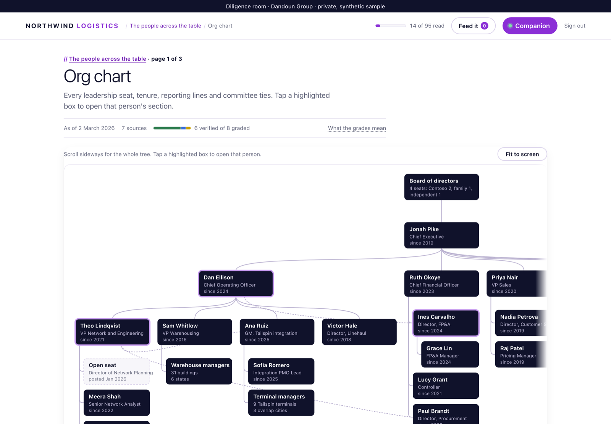
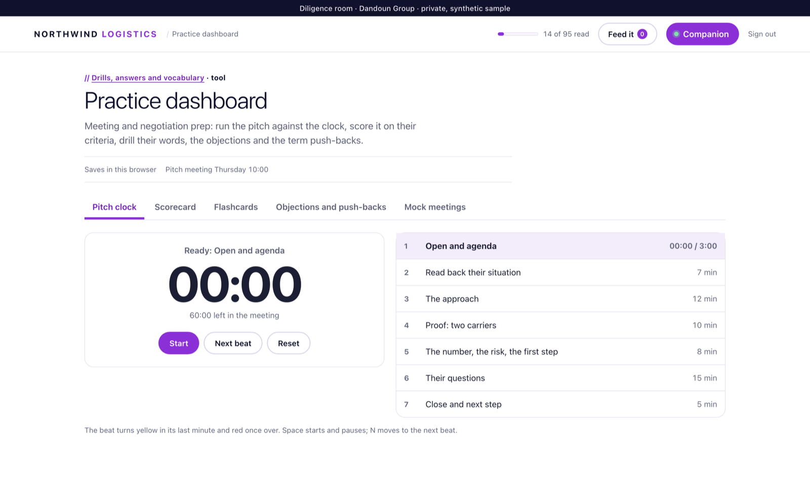
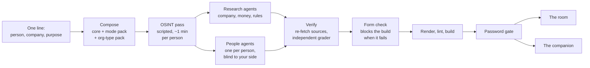

# Diligence rooms

[](https://github.com/anader298/diligence-rooms/actions/workflows/test.yml)

Due diligence on a company and the people you are about to meet. Type who you are meeting, their company and what the meeting is for. You get a private room built from graded public sources, plus a live companion for the meeting itself. It is built for high-stakes meetings: deals, partnerships, interviews. Rooms are built on your own machine with your own Claude Code or Codex account.


*Every screenshot shows synthetic data. The companies, their people and every link are invented.*

**Case study:** [How a private room prepares you for the people across the table](https://dandoungroup.com/case-studies/#diligence)

**Run it yourself:** clone it, connect your own Claude Code or Codex, and build rooms on your machine ([Launch it](#launch-it-on-your-machine)). Tested from a fresh download on 19 November 2026: a light room on a public company, built unattended with Claude Code, passed the depth check (sources and page count) at 100/100 (57 pages, 324 sources).

**A person's section.** Headshot frame, the verdict, what he judges on, and what drives him under four headings.


**The persona.** Proven, Mixed or Unproven in one line, then each claim set against the record, graded and sourced.


**The org chart.** Every seat, tenure, the open seat, reporting and committee lines. The people at the next meeting are ringed.



**The company.** What drives it, with evidence and a source on each line, and the charts behind it.


**Practice.** Pitch clock, scorecard on their criteria, flashcards, objections and mock meetings, saved in the browser.



**The OSINT dossier.** A scripted pass over public registries and pages, one tab per topic, every line tied to a ledger row with its source and grade.


**On a phone.** The one card, read last, and the companion, glanced at during the meeting.

<p align="center">

&nbsp;&nbsp;

</p>

## The problem

Before you sign a contract, take on a partner, pick a vendor or put money into a company, the other side knows its business far better than you do. Most of what you need is public: filings, accounts, regulators' records, the company's own documents, and a lot about the people you will meet, from their talks and posts to reviews by people who worked for them. Nobody assembles it around the people and the decision, so most teams walk in with a home-page read or pay for a consultant's brief.

## What it delivered

From the rooms built between August and November 2026, as published in the case study:

- **Eight counterparties diligenced:** three full rooms (a global consulting firm, an institutional asset owner and a fintech) and five lighter packages (three private equity firms and two venture-backed startups).
- **16 personas** of the people across the table, from public sources only, each usable to rehearse the meeting before it counts.
- **A filings bank of 36 instruments** for the asset owner, each graded by how it was verified, alongside five years of annual reports and a decade of regulatory correspondence.
- **Faster each time.** The method moved between rooms unchanged. The second full room took three days from intake, the third took one.
- **Honest about outcomes.** A room gets you into the meeting prepared; it does not decide the result. One room ended after the second meeting without an agreement, one counterparty has had a first meeting with no result recorded, and for one the room was built and nothing was sent.

## How it works



- **One line in, a whole room out.** A local studio reads the person, the company and the purpose, picks a mode (deal, audit, pitch or interviewing) and an organisation type (private equity, public company, asset owner, startup and five more), and composes the page set in seconds. Research runs only when you start it.
- **Scripts first, then agents.** A scripted OSINT pass (below) files what registries and public pages say about each person and the company into a ledger, each row with its source and grade. The room is a fixed set of buckets. Code works out whether each one was filled, searched and empty, or couldn't be checked. Agents hand in what they find as entries, and code grades them: an agent's finding is never Verified without a script source or an official record behind it.
- **Three sections to read.** **Start here** (summary, countdown and deadlines, the three things), then **1. The person** (one block per person, split into Personal and Professional), **2. The role, the deal, the specifics** (the ask, meetings, drills, the one card) and **3. The company** (what drives them, the money, filings, the outside view, the org chart). The mirror and the record sit in **Behind the room**.
- **Agents in parallel, blind where it matters.** Agents (Claude Code or Codex) run one fixed stage at a time. They hand in findings as entries and write the narrative pages. The instructions require a source on every line; code checks that every AI judgement cites findings that exist. The people agents are not given your side's file, so the profiles cannot flatter you. A separate agent re-fetches every source and recomputes every number; that check is a model, not code (see Methodology).
- **Every fact graded:** verified, partly verified, weak, inference, none found, not public or unknown. Every search, including the empty ones, is kept in the OSINT log. `npm run lint` scores each room out of 100 on sources, verified share and pages still empty.

**Map of the code.** An [interactive map](https://anader298.github.io/diligence-rooms/map/) of every part, file and step in plain English, separating what code enforces from what the AI is only instructed to do.

The full method is in [`pipeline/STANDARD.md`](pipeline/STANDARD.md) and every agent brief is in [`pipeline/PROMPTS.md`](pipeline/PROMPTS.md).

## Launch it on your machine

Everything runs locally, with your own AI account. Nothing is sent anywhere except the engine's own calls and the public sources it reads.

**You need:** Node 23.6 or later, git, and one of these, signed in or with an API key:
- [Claude Code](https://docs.claude.com/en/docs/claude-code) (`npm install -g @anthropic-ai/claude-code`, then run `claude` and type `/login`), or
- [Codex](https://github.com/openai/codex) (`npm install -g @openai/codex`, then `codex login`).

```sh
git clone https://github.com/anader298/diligence-rooms.git
cd diligence-rooms
npm install
npm run doctor          # checks Node, the engines, your sign-in and setup; prints the fix for anything missing
npm run studio          # http://localhost:8877, bound to this machine only
```

In the studio:

1. **Connect AI.** Pick Claude Code or Codex, signed-in account or API key (saved only in `.env`; the page shows the last four characters). Press **Test**: it sends one short message and shows your plan usage.
2. **Set the usage limit.** A run stops itself when plan usage passes it (default 65%). Pages written before the stop are kept. With an API key, set a max spend instead.
3. **About you.** Your name, organisation and the facts the room may quote. Used for the mirror and the people map, never on the pages about them.
4. **Start a room.** Who you are meeting, their company, what you want, the meeting and any deadlines. Press **Start**.
5. **Run research.** The run starts in the background with a readable log and a **Stop** button. Claude Code runs one orchestrator that starts its own agents; Codex runs each stage as a separate call, so the people stages never see your side. Questions only you can answer are listed on the room's row and marked `[FILL: …]` on the pages.
6. **Build and preview.** **Build all**, then **Preview**. Nothing is published.

The same run works from a terminal: `npm run run-room -- <slug>`. Each run uses your own Claude or ChatGPT plan, or bills your API key: a light room is a shorter run, a full room is hours of agent work.

**Try it without an engine.** Press **Build all**, then **Preview** on the Northwind row, to read the finished synthetic room.

## Public-source research in a minute: `npm run osint`

Before any agent starts, a scripted pass collects what public registries, APIs and pages say about each person and their company. It runs in under a minute (54 seconds on a large public-company CEO), needs no paid keys and has no dependencies (Node's built-in fetch). It writes three files per person in `rooms/<slug>/work/osint/<person>/`:

- `ledger.jsonl`: one row per finding (L-0001 upward) with value, source link, module, grade and tier (A registry or API, B scored match, C read from a page, D estimate). A line on a room page cites its ledger id.
- `osint.json`: the ledger plus what was searched and not found, and how each module ran.
- `dossier.html`: the tabbed page above (Personal, Professional, Company, Agenda, Politics, Money, Records, News, Pictures, Estimates, Accounts and identity, Timeline, Sources, Gaps, Run), with a filter, grade toggles and a red banner if the person appears to have just left the company.

```
npm run osint -- --name "Jane Doe" --company "Acme Corp" --domain acme.com --open
```

53 default modules in four lanes plus five opt-in heavy modules, each with a time budget. A module that fails or is refused is recorded as blocked, never as "found nothing":

| Area | Sources |
|---|---|
| Company | SEC EDGAR filings and XBRL financials, with SIC peers; 10-Q/10-K segments, KPIs and litigation; one resolved identity (SEC CIK, GLEIF LEI, Wikidata) with parents and subsidiaries; national registries (France, Norway, Czech Republic; UK with a free key); FDIC and NCUA; EPA enforcement; the leadership page; job boards (Greenhouse, Lever, Ashby, Workday and seven more); DOL Form 5500 headcount; Wikidata; news; DNS, RDAP and SaaS stack; certificate transparency; the web archive |
| The person, professional | SEC Forms 3 and 4 (title, trades, holdings), proxy pay table and bio, 8-K departures; FINRA BrokerCheck and SEC IAPD; NPI, state licence and bar registries; patents (Google Patents, USPTO); publications (ORCID, OpenAlex, Crossref); Wikipedia; books; podcasts and talks |
| The person, personal | web search (DuckDuckGo, Bing; Brave with a key); a username sweep across about 35 sites that counts a hit only when the profile's name matches; Gravatar and GitHub commits by work email; Keybase, Mastodon verified links and `rel=me` link pages; public profiles, blogs and package registries; hobby sites (Discogs, Letterboxd, chess.com); quotes; former and maiden names; image and reverse image search on the headshot |
| Politics and records | FEC donations and the company PAC; lobbying for the company and the person; FARA; federal awards; OFAC, HHS-OIG and the trade.gov Consolidated Screening List; OpenSanctions and CourtListener with a free key |
| Heavy, opt-in (`--heavy`, `--transcribe`) | headshot matched against every candidate avatar; article text; talk and podcast transcripts (Whisper); document metadata; every executive's proxy pay. Python sidecars, started only when there is input |
| Late | an identity score for every candidate account (log-odds over name, employer, city, shared handles and headshot reuse; verified needs two kinds of evidence); estimates for team size, budget, pay and deal size, each a range with its inputs |

**Tested on real people (19 to 20 November 2026), scripted pass only.** A public-company EVP: 141 findings in 32 s (proxy pay to the dollar, Form 4 title and trades, revenue, segments, litigation, 27 open roles). A VP at a private manufacturer: 62 findings in 46 s. A recruiter at a private software company: 70 findings in 30 s. Two executives who had just announced they were leaving were flagged with a departure alert. An independent audit of 168 rows found 93% of rows graded verified exactly right and every SEC and Form 5500 figure exact; the errors it found (namesakes, nicknames, units, stale figures) are fixed and tested. The personal side is the weak half: unless the person posts publicly, hobbies, family and causes come back empty, and the dossier says so. Details in [docs/osint.md](docs/osint.md).

**The form.** Every room fills the same buckets, defined as JSON packs in `config/form/` (core per person, core company, one per mode and org type, optional practice). Code computes each bucket's state from the ledgers (filled with grade and source, searched and empty, couldn't check, no tool yet) and renders it on its page; agents hand in entries (`npm run entry`); code regrades every row when it reads the ledger, and an agent's entry needs a script source or an official record to be Verified; AI judgement must cite ledger ids that exist; the build refuses a room that fails the form check unless `--draft`. How to add a bucket, a pack or a tool: [docs/form.md](docs/form.md). The bucket list: [docs/form-buckets.md](docs/form-buckets.md).

## The companion: answers on screen during the meeting

`/<room>/assist.html` runs on a phone or a second screen, behind the room's password. Audio is transcribed in 8-second chunks. A **fast lane** puts a quick card on screen within seconds when it hears a question or a push-back: the question, one line to open with, and two or three facts with the room page each comes from. A **deep lane**, with the whole room as a cached prompt, then streams a considered answer: the best answer, the evidence, what this person is really testing, a question to ask back, and the risk to avoid. If the room does not cover the question, the card says so.

Calculations are picked by the model and computed by code (`recheckCalc`). The microphone stays off until you confirm everyone has agreed to be recorded. The session is saved on the device only and exports as markdown for the debrief. Open `assist.html#demo` to see it without a microphone or a model.

A no-code alternative, the **silent helper** ([`helper/SILENT-HELPER.md`](helper/SILENT-HELPER.md)), runs the same cards in Claude's voice mode from a Claude Project holding the room's knowledge file.

## Licensed data

Public sources come first. Licensed data (Apollo in use; adapters for ZoomInfo, Lusha, Cognism, Clay, Crunchbase, PitchBook, LinkedIn exports and CSV are in the code and off by default) fills titles, history, firmographics and contact routes. `npm run enrich -- <slug>` prints a credit estimate per provider and spends nothing until you run it again with `--yes`. Every licensed value is graded "partly verified" until a public source confirms it.

Contact details a provider returns are stored with their kind (work, personal or unknown) and source, and checked against the company's own records (website, state registry, SEC filings, domain WHOIS). A match is marked "business of record": in small and owner-run firms the founder's personal email or address is often the business one too.

## The gate

One Netlify Edge Function (`netlify/edge-functions/room-gate.ts`) guards every room with its own password (`ROOM_PASSWORD_<SLUG>`). A correct password sets a signed, HttpOnly session cookie (HMAC-SHA256 with `ROOM_COOKIE_SECRET`, through Web Crypto). A room with no password returns 404, so the site does not reveal which rooms exist. The companion's functions sit behind the same gate, and every room is served `noindex` and `no-store`.


## Boundaries

Public or licensed sources only. No logging in to see non-public content, no fake accounts, no breached or leaked data, nothing on minors, no real-time location. LinkedIn is never logged into or crawled: the username sweep reads only the title tag of a public, logged-out profile URL, and agents read search-engine previews. A residential address appears only when it is a business address of record, labelled as such. Recording law differs by place: get every party's consent before you turn the companion on. This repo is a tool, not legal advice.

## Limits

- **A shared password per room, not accounts.** Anyone with the password can read the room. There is no rate limiting on the login form.
- **A room is only as good as what they publish.** Private companies stay partly dark. The pages say "not public" rather than guess.
- **Rooms go stale.** People leave between the build and the meeting. Every page carries its as-of date, and the OSINT pass flags recent departures.
- **Inference creeps.** "In essentially every case" turned out to be six uses when recounted. The corrections log exists because it happens.
- **Free sources throttle.** Search engines and the shared FEC key rate-limit a busy IP; a module that is refused says "blocked, not checked" and names the free key that fixes it.
- **The live helper depends on the room and the mic.** Transcription garbles names, and the answer is only as good as the room behind it.

## Methodology

Use: Analyze. Lever: commercial and risk. Before a negotiation, partnership talk or interview, a leader sees the counterparty's money, rules and people, with every claim sourced, and fewer surprises reach the table.

| Step | Done by | Check |
|---|---|---|
| Public-source pass | Code (`npm run osint`) | Ledger row with source and grade; refused calls recorded as blocked |
| Research the company and each person | Claude Code or Codex agents in parallel; people agents never see our side's file | A source link on every line; every search logged |
| Licensed data | Code; a person approves the spend | Nothing spent until `--yes`; values graded "partly" until confirmed |
| Verify sources and numbers | Separate model agents | Re-fetch and recount: a model checking a model |
| Companion cards | Model, fast and deep lanes | `validateCard`: known type, grade, a source page on every fact; "Not in room" allowed |
| Companion calculations | Model picks inputs; code computes (`recheckCalc`) | The code's result replaces the model's |
| Publish a room; turn on the mic | Person | The pipeline never deploys; the mic stays off until everyone consents |

- **Playbook or agent, and why.** Mostly a playbook (`pipeline/STANDARD.md`, briefs P0 to P10). Research fans out to agents because the reading is broad and independent; one render step writes the pages; the companion is two fixed calls per question.
- **How it was built.** Personas that graded their own practice questions agreed with themselves, so grading moved to a separate agent. The OSINT pass was reviewed from a fresh clone by independent agents on five real executives, and the errors they found were fixed, with tests.
- **How it's checked.** 275 tests (`npm test`). `npm run lint` fails the 16-page synthetic source room at 67/100, by design: 40+ pages are expected.
- **Limits.** Card JSON is read with a regex, the fast lane defaults to an Opus-class model, and the research number check is a model. Next: structured outputs, a small fast model, a code tie-out and a labelled question set.

How I build with AI: [github.com/anader298/how-i-build-with-ai](https://github.com/anader298/how-i-build-with-ai)

## The sample room and other commands

[`examples/northwind-sample/`](examples/northwind-sample/) is the finished sample as static pages: Avery Freight Analytics prepares to pitch Northwind Logistics, across the table from Dan Ellison (COO), Theo Lindqvist and Ines Carvalho. Twelve pages ship in full and the rest of the 95 are listed. Open `examples/northwind-sample/index.html`; it makes no network calls. [`rooms/northwind/`](rooms/northwind/) is the same counterparty as a source room, to show how the engine renders one.

```sh
npm test                # 275 tests
npm run build           # every room into site/ (a room failing its form check is refused; --draft builds it anyway)
npm run lint            # depth score per room
npm run preview         # http://localhost:8888, no password
cp .env.example .env    # set ROOM_COOKIE_SECRET and ROOM_PASSWORD_NORTHWIND
npm run serve           # http://localhost:8888/northwind/ behind the real gate
npm run new-room -- acme "Acme Corp"   # a room from the skeleton
```

**Publish your own copy.** Connect your fork to Netlify, keep `netlify.toml`, set `ROOM_COOKIE_SECRET` and one `ROOM_PASSWORD_<SLUG>` per room, and enable AI Gateway for the companion. Commit only the rooms you mean to publish, and keep the repo private if they hold real research.

## Stack

Static HTML, CSS and plain JavaScript built by a Node script, with no framework. Netlify Edge Functions (TypeScript) for the gate. Netlify Functions for the companion: Claude through the Anthropic SDK with prompt caching, and Gemini for speech to text, through Netlify AI Gateway. Claude Code or Codex for research. `node:test` for the tests.

## About this public copy

The live rooms are private: they hold research on real companies and real people, stay behind their passwords and are deleted when the meeting is done. This copy holds the engine, the standard, the prompts and one synthetic sample. It was published as one commit on 12 November 2026, and every change since is its own commit.

## Author and licence

Anthony Nader, Dandoun Group. Read the [diligence rooms case study](https://dandoungroup.com/case-studies/#diligence). MIT licence; see [LICENSE](LICENSE).
