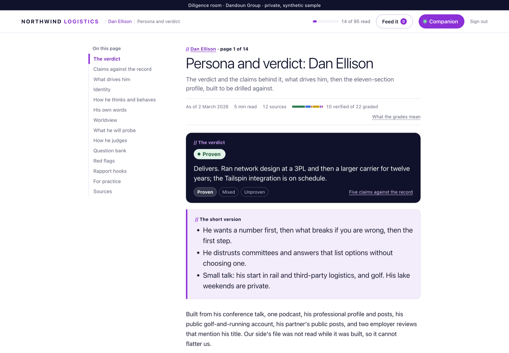
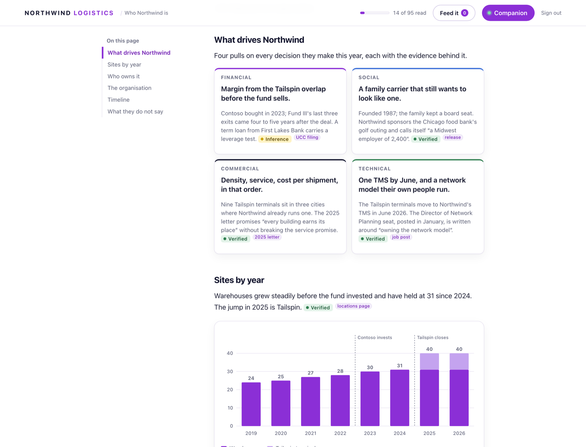
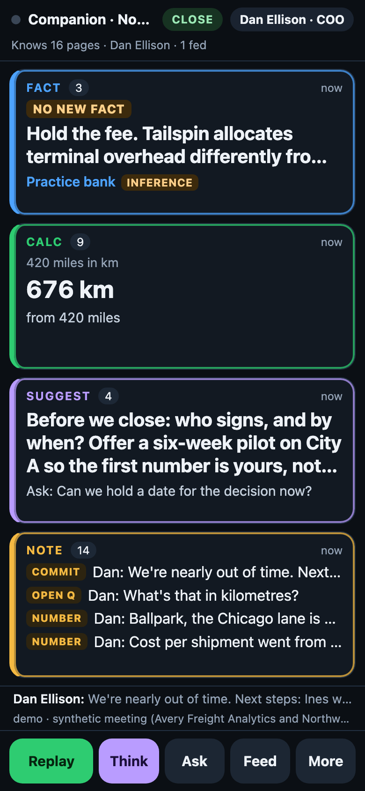
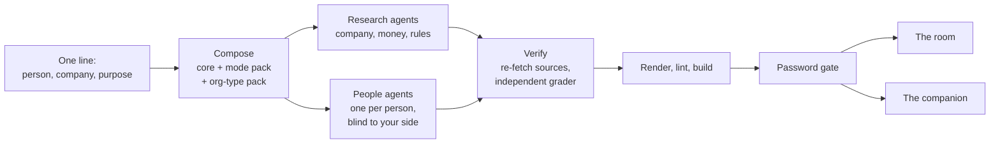
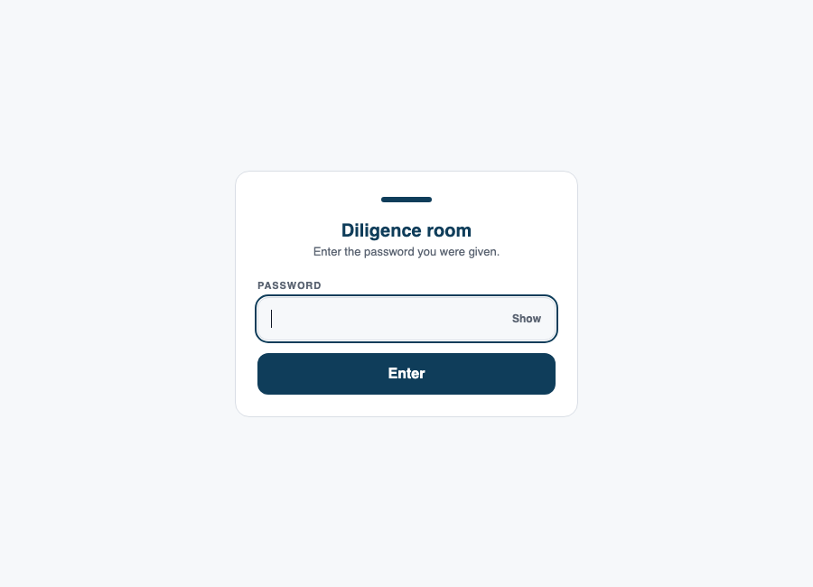

# Diligence rooms

Due diligence on a company and the people you are about to meet. Type who you are meeting, their company and what the meeting is for. Get a private room built from graded public sources and our licensed data (Apollo), with a live companion for the meeting itself. Built for C-suite executives and leadership teams; the tool is not public, and rooms are built privately.


*Every screenshot shows synthetic data. The companies, their people and every link are invented.*

**Case study:** [How a private room prepares you for the people across the table](https://dandoungroup.com/case-studies/#diligence)

<table>
<tr>
<td width="50%"></td>
<td width="50%"></td>
</tr>
<tr>
<td><sub><b>A person's section.</b> Headshot frame, the verdict, what he judges on, and what drives him under four headings.</sub></td>
<td><sub><b>The persona.</b> Proven, Mixed or Unproven in one line, then each claim set against the record, graded and sourced.</sub></td>
</tr>
<tr>
<td></td>
<td></td>
</tr>
<tr>
<td><sub><b>The org chart.</b> Every seat, tenure, the open seat, reporting and committee lines. The people at the next meeting are ringed.</sub></td>
<td><sub><b>The company.</b> What drives it, with evidence and a source on each line, and the charts behind it.</sub></td>
</tr>
<tr>
<td></td>
<td>
<table><tr>
<td width="50%"></td>
<td width="50%"></td>
</tr></table>
</td>
</tr>
<tr>
<td><sub><b>Practice.</b> Pitch clock, scorecard on their criteria, flashcards, objections and mock meetings, saved in the browser.</sub></td>
<td><sub><b>On a phone.</b> The one card, read last, and the companion, glanced at during the meeting.</sub></td>
</tr>
</table>

## The problem

Before you sign a contract, take on a partner, pick a vendor or put money into a company, the other side knows its business far better than you do. Most of what you need is public: filings, accounts, regulators' records, the company's own documents, and a lot about the people you will meet, from their talks and posts to reviews by people who worked for them. Nobody assembles it around the people and the decision, so most teams walk in with a home-page read or pay for a consultant's brief.

## What it delivered

From the rooms built between August and November 2026, as published in the case study:

- **Eight counterparties diligenced:** three full rooms, on a global consulting firm, an institutional asset owner and a fintech, and five lighter packages on three private equity firms and two venture-backed startups.
- **16 personas** of the people across the table, built from public sources only, each one usable to rehearse the meeting before it counts.
- **A filings bank of 36 instruments** for the asset owner, each graded by how it was verified, alongside five years of its annual reports and a decade of regulatory correspondence.
- **Faster each time.** The method moved between rooms unchanged. The second full room took three days from intake, the third took one.
- **Honest about outcomes.** A room gets you into the meeting prepared. It does not decide the result: one room ended after the second meeting without an agreement, one counterparty has had a first meeting with no result recorded, and for one the room was built and nothing was sent.

## How it works



- **One line in, a whole room out.** A local studio reads the person, the company and the purpose, picks a mode (deal, audit, pitch, or interviewing) and an organisation type (private equity, public company, asset owner, startup and five more), and composes the page set. Composing takes seconds; research runs only when you start it.
- **The company first, then its people.** Pages cover who they are, their money, public financials, the rules they work under, filings, partners, reviews and news. Each person across the table gets their own pages, from public record and network to a profile of how they judge.
- **Three sections to open.** The reader sees **Start here** on top (summary, countdown and deadlines, the three things), then **1. The person**, one block per person split into Personal and Professional, **2. The role, the deal, the specifics** (the ask, the deal pages, meetings and the companion, the drills, the one card) and **3. The company** (who they are and what drives them, the money, filings, the outside view, the org chart and people map, the org-type pack). The mirror and the record sit in a closed **Behind the room** at the bottom.
- **A verdict, motives and photos.** Each persona opens with a verdict, **Proven**, **Mixed** or **Unproven**: one plain line, then their claims against the record, each graded and sourced. "What drives them" covers the person and the company under four headings: financial, social, commercial and technical. A headshot frame and life photos, each with its source, sit on the person pages.
- **Public sources plus our licensed data.** Lookups run on our own Apollo account; the client connects nothing. Licensed data counts as partly verified until a public source confirms it. More providers can be added later.
- **Agents in parallel, blind where it matters.** Claude Code agents gather and draft every page with a source link on each line. The people agents never read your side's file, so the profiles cannot flatter you. A separate agent re-fetches every source and recomputes every number.
- **Every fact graded.** Each one is verified, partly verified, weak, inference, none found, not public or unknown. The reader's pages show what was found; every search, including the empty ones, is kept in the OSINT log behind the room. `npm run lint` scores each room out of 100 on sources, verified share and pages still empty.
- **A companion with two lanes.** During the meeting, a phone page transcribes the conversation in 8-second chunks. A fast model shows a quick card when it hears a question. A stronger model, with the whole room as a cached prompt, writes the considered answer a few seconds later. If the room does not cover the question, the card says so.
- **A gate at the edge.** One Netlify Edge Function guards every room with its own password and a signed, HttpOnly session cookie. A room with no password returns 404, so the site does not reveal which rooms exist. The companion's API sits behind the same gate.

The full method is in [`pipeline/STANDARD.md`](pipeline/STANDARD.md) and every agent brief is in [`pipeline/PROMPTS.md`](pipeline/PROMPTS.md).

## The sample room

[`examples/northwind-sample/`](examples/northwind-sample/) is the finished sample, as static pages: Avery Freight Analytics prepares to pitch Northwind Logistics for a network-planning contract, across the table from Dan Ellison (COO), Theo Lindqvist and Ines Carvalho. It ships twelve pages in full (the front page, Dan's section, his persona, personal life and circles, the company, the org chart, the one card, the practice dashboard, documents, glossary and the wider org) and lists the rest of the 95 so the shape of a whole room is visible. Open `examples/northwind-sample/index.html` in a browser; it makes no network calls. The Companion button is added by the build: run `npm run build` and `npm run preview`, then open `/northwind-sample/`.

[`rooms/northwind/`](rooms/northwind/) is the same counterparty as a source room (`room.json` plus page bodies), so `npm run build` shows how the engine renders a room: the groups, the person cards with their verdicts, the countdown, the grade donuts, the jump bar and the source chips.

## The helpers: answers on screen during the conversation

Preparation gets you into the room. The helpers keep the room with you while you are in it.

**Silent helper** ([`helper/SILENT-HELPER.md`](helper/SILENT-HELPER.md)). A single instruction file for Claude's voice mode. Load it into a Claude Project with the room's knowledge file, start voice mode and mute the speaker. It listens, never talks back, and prints a short card on screen for every question the other side asks: the question, one sentence to open with, three facts from the room, and the page they came from. If the room does not cover it, it says so and gives one honest bridge sentence. It knows who is speaking from the personas and shapes the answer to how that person judges.

**The companion** (`/<room>/assist.html`). The companion as a web page on a phone or a second screen, behind the room's password. It listens and helps while you talk, through two lanes:

- **Fast lane** (`ASSIST_FAST_MODEL`, default `claude-opus-5-5`). Audio is recorded in 8-second chunks and transcribed on the server, falling back to the phone's own speech recognition. The fast lane cleans up the rolling transcript, guesses who is speaking, and when it hears a question or a push-back it puts a quick card on screen within seconds: the question, one line to open with, and two or three facts with the room page each comes from.
- **Deep lane** (`ASSIST_DEEP_MODEL`, default `claude-fable-5-2`). For every question the fast lane spots, or when you press Think, it streams a considered answer underneath the card: the best answer in our words, the evidence from the room, what this person's persona is really testing, a question to ask back, and the risk to avoid. The whole room is the cached system prompt, so each call after the first pays only for the question and the transcript.

Quick cards stack with a pin and next control; a typed question box covers anything it missed; a silent mode turns off vibration and motion and dims the screen. The microphone stays off until you confirm that everyone in the conversation has agreed to be recorded (required in two-party consent states). The session (transcript, cards and deep answers) is saved on the device only and exports as a markdown file for the debrief. Every room has a `companion` page with the setup checklist. Open `assist.html#demo` to see it without a microphone or a model.

The build writes both helpers' knowledge for every room automatically: `site/<room>/knowledge.md` for the silent helper, and a JSON copy (with the people, meetings and summary) for the companion's functions.

## The data behind it

Public sources plus our licensed data (Apollo). We run our own Apollo account; a client is never asked to connect an account, share a login or send an export. The adapters for the other providers below stay in the code for later and are off unless enabled.

Licensed data replaces scraping. `npm run enrich -- <slug>` asks the enabled providers for the people and the company in a room. It prints a credit estimate per provider and stops; nothing is spent until you run it again with `--yes` (or confirm in the studio's Licensed data panel). Results land in `rooms/<slug>/work/connectors/`: one file per provider, `merged.json` with per-field provenance, and `conflicts.json` where providers disagree. Every value is graded partly, even when two providers agree, until the research stage confirms it at a public source.

Contact details are kept, not dropped. In small and owner-run firms the founder's personal email, mobile or house is often the business address too, so every email, phone and address a provider returns is stored with its kind (work, personal or unknown), phone type and source. The merge checks each one against the company's own records (website, state registry, SEC / Form ADV / Form D / 990, UCC, domain WHOIS, saved in `work/business-records.json`) and marks a match "business of record". Rooms show them in a "Contact routes" table (Value, Kind, Business of record?, Source, Grade). `revealPersonal` in `config/connectors.json` (default on) asks providers for personal emails and mobiles where they charge extra, and the estimate includes those credits.

**Boundaries.** Public or licensed sources only. Nothing on minors, no real-time location, no breached or leaked data, no logging in to see non-public content and no LinkedIn scraping. A residential address appears only when it is a contact or business address of record, labelled as such.

| Provider | What it fills | Auth | Status |
|---|---|---|---|
| Apollo.io | titles and history, seniority, departments, city, profile links, work email; work and personal emails, phones, address; company size, revenue, funding, tech, job postings, office address | `APOLLO_API_KEY`, or the Apollo MCP server in Claude Code (`apollo-mcp`, no key here) | verified endpoint |
| ZoomInfo | titles and history, education, seniority, departments, work email, direct line, mobile, street address; firmographics | `ZOOMINFO_USERNAME` + `ZOOMINFO_PASSWORD`, or `ZOOMINFO_ACCESS_TOKEN` | unverified endpoint |
| Lusha | current and past titles, seniority, departments, city, work and private emails, phones; company profile | `LUSHA_API_KEY` | verified (people); unverified endpoint (company) |
| Cognism | titles, seniority, department, city, emails, direct, office and mobile lines, address; company profile | `COGNISM_API_KEY` | unverified endpoint |
| Clay | whatever your table's enrichment columns return | `CLAY_WEBHOOK_URL`, then the table's CSV export | unverified endpoint |
| Crunchbase | funding rounds, investors, parent and subsidiaries, headcount range; people's jobs and degrees | `CRUNCHBASE_API_KEY` | verified (organization lookup); unverified endpoint (search, people, cards) |
| PitchBook | deals and investors, headcount, parent; people's positions and education | `PITCHBOOK_API_KEY` | unverified endpoint |
| LinkedIn export | current title and the date we connected (our own Connections.csv), Sales Navigator lists | files in `work/imports/linkedin/` | local file |
| CSV | anything in a CRM or data-room export, by column name | files in `work/imports/` | local file |

"Unverified endpoint" means the provider's reference is behind a customer login; the adapter follows the documented minimum and should be checked against the provider's docs before it is enabled. Enable providers in `config/connectors.json` (copy `config/connectors.example.json`); Apollo is the one in use.

## The gate

One Netlify Edge Function (`netlify/edge-functions/room-gate.ts`) sits in front of every room. Each room has its own password, set as `ROOM_PASSWORD_<SLUG>` (slug upper-cased, dashes become underscores); a room with no password returns 404, so the site does not reveal which rooms exist. A correct password sets a signed, HttpOnly session cookie (HMAC-SHA256 with `ROOM_COOKIE_SECRET`, through Web Crypto); changing the secret signs everyone out. `/<room>/__logout` ends the session. The companion's functions sit behind the same gate, and every room is served with `noindex` and `no-store` headers.



## About this public copy

The live rooms are private. They hold research on real companies and real people, so they stay behind their passwords and are deleted when the meeting is done. This copy is sanitized: it holds the engine, the standard, the prompts and one synthetic sample, where Avery Freight Analytics prepares to meet Northwind Logistics about a network-planning contract. Every company, person and link in it is invented. The private version changes first; this copy is fixed at the point it was published.

## Boundaries

Public information only. No logging in to see non-public content, no fake accounts, no breached data, nothing on minors, and no home addresses or personal phone numbers on any page. Recording law differs by place: get every party's consent before you turn the companion on. This repo is a tool, not legal advice.

## Limits

- **A shared password per room, not accounts.** Anyone with the password can read the room. There is no rate limiting on the login form.
- **A room is only as good as what they publish.** Private companies stay partly dark. The pages say "not public" rather than guess.
- **Rooms go stale.** People leave between the build and the meeting. Every page carries its as-of date.
- **Inference creeps.** "In essentially every case" turned out to be six uses when recounted. The corrections log exists because it happens.
- **Self-grading is not evidence.** Practice answers are graded by something other than the persona that asked.
- **The live helper depends on the room and the mic.** Transcription takes a few seconds per chunk and garbles names; the answer is only as good as the room behind it.

## Stack

Static HTML, CSS and plain JavaScript built by a Node script, with no framework. Netlify Edge Functions (TypeScript) for the gate, with HMAC-SHA256 sessions from Web Crypto. Netlify Functions for the companion: Claude through the Anthropic SDK with prompt caching, and Gemini for speech to text, through Netlify AI Gateway. Claude Code agents for research. `node:test` for the gate, session, composer and lint tests.

## Licence

MIT. See [LICENSE](LICENSE).

## Author

Anthony Nader. One of several side ventures he builds to learn. Read the [diligence rooms case study](https://dandoungroup.com/case-studies/#diligence).

## Run it locally

Requires Node 23.6 or later.

```sh
npm install
npm run studio          # http://localhost:8877, bound to this machine only
```

Type who you are meeting, their company and the purpose, for example `Dan Ellison` / `Northwind Logistics` / `win a network-planning contract`. The studio picks the mode and organisation type and shows the page list. Press **Build all**, then **Preview** on the Northwind row, to read the finished synthetic room. Filling a new room needs Claude Code with model access (`STUDIO_RUN=1 npm run studio`).

```sh
npm test                # gate, session, composer and lint tests
npm run build           # every room into site/
npm run lint            # depth score per room
npm run preview         # http://localhost:8888, no password
cp .env.example .env    # set ROOM_COOKIE_SECRET and ROOM_PASSWORD_NORTHWIND
npm run serve           # http://localhost:8888/northwind/ behind the real gate
```

`npm run serve` runs the same edge function as production, so the password form, cookie and redirects behave as deployed. The companion's functions need `netlify dev` (or a deploy) and model access.

Start a new room from the skeleton:

```sh
npm run new-room -- acme "Acme Corp"
# fill in rooms/acme/pages/*.html, drop the sections you do not need
# set ROOM_PASSWORD_ACME, then npm run build
```

Deploy on Netlify: connect the repo, keep `netlify.toml`, set `ROOM_COOKIE_SECRET` and one `ROOM_PASSWORD_<SLUG>` per room, and enable AI Gateway for the companion.
